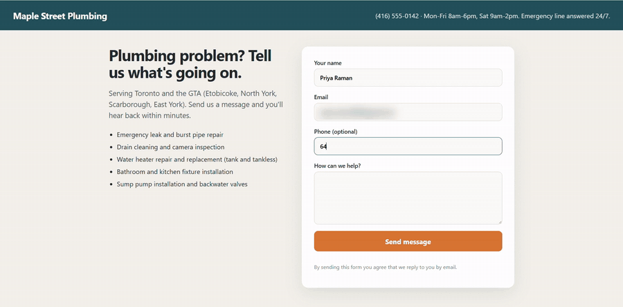
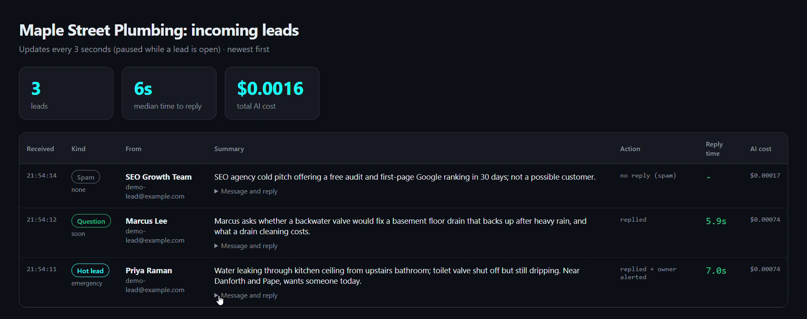
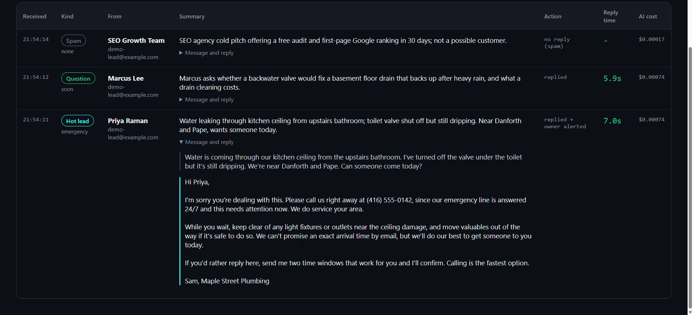

# AI Lead Reply

Answer every new contact-form lead in under a minute: Claude sorts the message (hot lead, question or spam), writes a personal reply in your business's voice, emails it, alerts you about hot leads and logs everything to a spreadsheet.

Built for the Cron Job Club video *"I Built an AI That Replies to Every New Lead in 60 Seconds."* ▶ **[Watch it on YouTube](https://www.youtube.com/@CronJobClub)**



*Real run, typing sped up. The reply was sent 6.1 seconds after the lead hit Send.*

<table>
<tr>
<td width="50%"></td>
<td width="50%"></td>
</tr>
<tr>
<td>The dashboard: every lead sorted, timed and costed</td>
<td>The reply Claude wrote for the hot lead</td>
</tr>
</table>

```
Contact form ──▶ /lead webhook ──▶ Claude (sort + draft) ──┬─ hot lead ─▶ reply + alert the owner
                                                            ├─ question ─▶ reply
                                                            └─ spam ─────▶ no reply
                                     every lead ──▶ data/leads.csv + /leads dashboard
```

## What it costs

One Claude call per lead. With `claude-haiku-5-5` that is a fraction of a cent per lead (about 1,300 tokens in and 250 out). The exact cost of every lead is in the log and on the dashboard. Prices: <https://platform.claude.com/docs/en/about-claude/pricing>

## Setup (about 10 minutes)

You need **Python 3.10 or newer** and a **Claude API key** from <https://platform.claude.com> (add a few dollars of credit).

```bash
git clone https://github.com/cronjobclub/ai-lead-reply.git
cd ai-lead-reply

python3 -m venv .venv
source .venv/bin/activate          # Windows: .venv\Scripts\activate
pip install -r requirements.txt

cp .env.example .env               # Windows: copy .env.example .env
```

Open `.env` and set at least:

```
ANTHROPIC_API_KEY=sk-ant-...
OWNER_EMAIL=you@yourbusiness.com
```

Start it:

```bash
uvicorn app.main:app --reload
```

- Contact form: <http://127.0.0.1:8000>
- Lead dashboard: <http://127.0.0.1:8000/leads>

Fill in the form, or send three test leads (an emergency, a question and spam):

```bash
python scripts/send_demo_leads.py
```

## Make it yours

Edit **`business_profile.yaml`**: name, services, service area, hours, what you may say about prices, how to book, your tone and things it must never promise. No code changes needed. Restart the app after editing.

## Sending real email

By default `SEND_MODE=outbox`, so emails are saved as `.eml` files in `./outbox` (double-click to open them in your mail app). When the replies look right:

1. Turn on 2-Step Verification for your Google account.
2. Create an app password: Google Account → Security → 2-Step Verification → App passwords.
3. In `.env`:
   ```
   SEND_MODE=smtp
   SMTP_USER=you@gmail.com
   SMTP_PASSWORD=your16charapppassword
   FROM_EMAIL=you@gmail.com
   ```

For high volumes or your own domain, use a sending service (Resend, Postmark, Amazon SES); only `app/mailer.py` changes.

## Safety switches

| Setting | What it does |
| --- | --- |
| `REVIEW_MODE=true` | Replies go to **you** for approval instead of to the customer. Start here if you're nervous. |
| `business_profile.yaml → never` | Rules Claude must always follow (no exact arrival times, no invented prices). |
| `ai_disclosure` | A line under every reply saying an assistant drafted it. Keep it: it's honest and builds trust. |
| Hidden honeypot field | Bots that fill it in are marked as spam without calling Claude. |
| Failure fallback | If Claude or email fails, you get a "NEEDS MANUAL REPLY" email. A lead is never lost. |

## Using your existing website form

Point any form (or Zapier, Make, n8n) at `POST /lead` with fields `name`, `email`, `phone` (optional) and `message`, as a normal form post or JSON. To receive leads from the internet, the app must run on a server rather than your laptop (Render, Railway, Fly.io or any small VPS). That's the next video.

## Project layout

```
app/
  main.py        web app: form page, /lead webhook, /leads dashboard
  pipeline.py    what happens to one lead
  ai.py          the Claude call (prompt + JSON schema)
  mailer.py      SMTP or outbox
  store.py       leads.csv
  pages.py       HTML for the form and dashboard
  config.py      .env and business_profile.yaml
business_profile.yaml
scripts/send_demo_leads.py
tests/           offline tests (no API key needed): python -m pytest
```

## Legal note

Replying to someone who contacted you is generally fine under anti-spam laws like Canada's CASL, but adding them to a marketing list is not. This is not legal advice; check the rules where you operate.

MIT licence.
